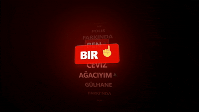
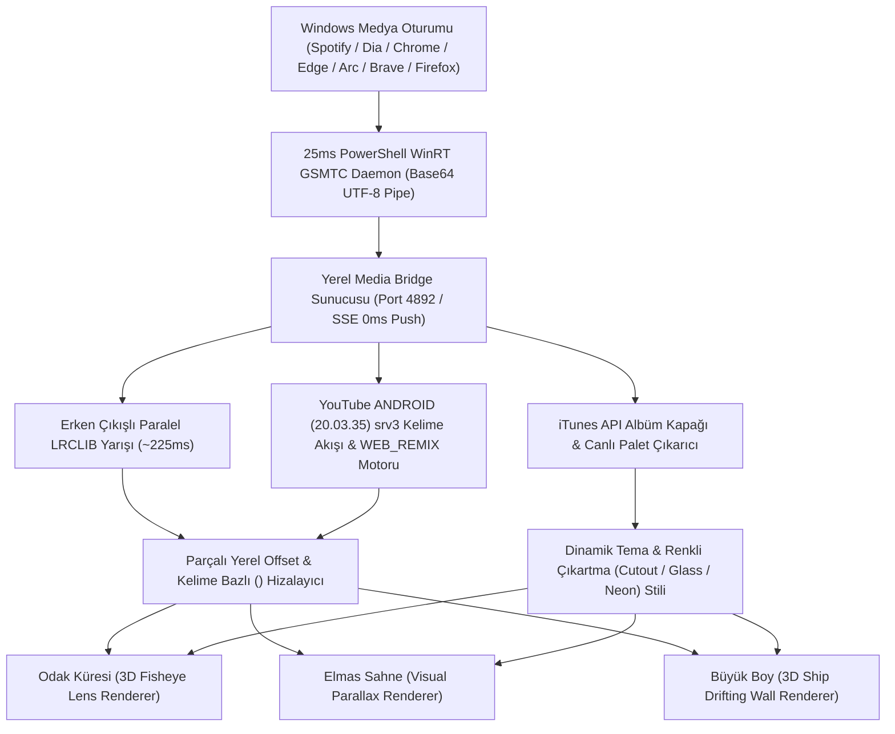
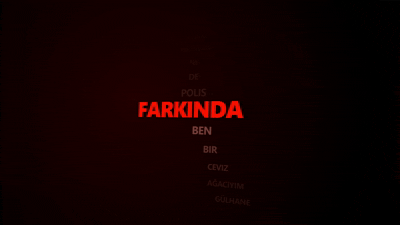

<div align="center">

# Lyricfy — Gerçek Zamanlı 3D Kinetik Şarkı Sözü & Paralaks Sahne Motoru

<p align="center">
  <strong>Windows 10 ve 11 için Spotify ve YouTube Music destekli, kelime kelime (word-by-word) senkronize 3D kinetik tipografi ve masaüstü söz sahnesi.</strong><br>
  <em>Şarkı sözleriniz yaşayan bir 3D sahneye dönüşsün: Küresel Fisheye lens distorsiyonu, bağlamsal 3D emojiler, albüm kapağından canlı renk çıkarımı ve hibrit YouTube transkript hizalama.</em>
</p>

<p align="center">
  <a href="LICENSE"></a>
  <a href="https://github.com/omerfys/Lyricfy/stargazers"></a>
  <a href="https://www.typescriptlang.org/"></a>
  <a href="https://react.dev/"></a>
  <a href="https://www.electronjs.org/"></a>
  <a href="https://tailwindcss.com/"></a>
  
  
</p>

<br>

> **Lyricfy**, Windows üzerinde çalan müziği hiçbir API anahtarı veya hesap girişi gerektirmeden yakalayan; şarkı sözlerini kelime kelime (word-by-word) renkli çıkartma rozetleri, bağlamsal 3D hareketli emojiler ve optik Fisheye / 3D süzülen duvar efektleriyle ekrana taşıyan açık kaynaklı bir masaüstü uygulamasıdır. Spotify ve YouTube Music oturumlarını milisaniyelik hassasiyetle takip ederken, albüm kapağındaki baskın renkleri gerçek zamanlı olarak sahne ışıklandırmasına uygular.

[Başlangıç](#hızlı-başlangıç--kurulum) • [Özellikler](#özellikler-features) • [Hibrit Senkronizasyon](#spotify--youtube-music-hibrit-senkronizasyon-motoru) • [Mimari](#mimari--çalışma-prensibi) • [Otomatik Renk Teması](#albüm-kapağı-otomatik-renk-senkronu-auto-sync) • [English Overview](#english-overview)

<br>

<div align="center">
  
  <p align="center"><em>▲ Kelime bazlı (word-by-word) renkli çıkartma rozetleri, 3D Fisheye küresel optik lens ve canlı senkron sahnesi</em></p>
</div>

---

</div>

## İçindekiler (Table of Contents)

- [Proje Vizyonu](#proje-vizyonu)
- [Özellikler (Features)](#özellikler-features)
- [Spotify & YouTube Music Hibrit Senkronizasyon Motoru](#spotify--youtube-music-hibrit-senkronizasyon-motoru)
- [Mimari & Çalışma Prensibi](#mimari--çalışma-prensibi)
- [Albüm Kapağı Otomatik Renk Senkronu (Auto Sync)](#albüm-kapağı-otomatik-renk-senkronu-auto-sync)
- [3 Boyutlu Görsel Sahneler & Şeffaf Masaüstü Modu](#3-boyutlu-görsel-sahneler--şeffaf-masaüstü-modu)
- [Bağlamsal Türkçe Kök Analizi & 3D Emoji Sistemi](#bağlamsal-türkçe-kök-analizi--3d-emoji-sistemi)
- [Hızlı Başlangıç & Kurulum](#hızlı-başlangıç--kurulum)
- [Glassmorphism Kontrol Paneli](#glassmorphism-kontrol-paneli)
- [Sıkça Sorulan Sorular (FAQ)](#sıkça-sorulan-sorular-faq)
- [English Overview](#english-overview)
- [SEO Anahtar Kelimeler (SEO Index)](#seo-anahtar-kelimeler-seo-index)
- [Lisans & Yazar](#lisans--yazar)

---

## Proje Vizyonu

Standart müzik çalarların şarkı sözü ekranları düz bir metin listesinden ibarettir; sadece satır bazlı kayar, görsel derinlik sunmaz ve video kliplerdeki uzun giriş (intro) farklarında senkronu kaybeder.

**Lyricfy**, müzik dinleme deneyimini kinetik bir görsel şölene dönüştürür:
1. **Kelime Bazlı Kinetik Tipografi (Varsayılan Tek Kelime Modu):** Uygulama varsayılan olarak **Tek Kelime** modunda açılır; şarkıcının o salisede söylediği kelime canlı bir çıkartma kutusuna (`cutout` / `glass` / `neon` sticker badge) dönüşür, hafif bir açıyla eğilir ve etrafında neon bir parlama oluşturur. Uzun ve tireli kelimelerde dinamik font ölçekleme devreye girerek ekran dengesini korur.
2. **25ms (40 Hz) Donanım Taraması & ~225ms Paralel Söz Motoru:** Spotify API anahtarı veya OAuth girişi istemez. Doğrudan Windows GSMTC (Global System Media Transport Controls) üzerinden **25 ms** aralıklarla ve kayıpsız **Base64 UTF-8** borusuyla çalışır; `Dia`, `Arc`, `Zen`, `Brave`, `Opera`, `Vivaldi`, `Firefox`, `Chrome` ve `Edge` dahil tüm tarayıcıları anında algılar.
3. **5 Katmanlı YouTube Music `ANDROID` InnerTube `srv3` & LRCLIB Zekası:** YouTube'un resmi `ANDROID (20.03.35)` InnerTube `/youtubei/v1/player` ve YouTube Music `WEB_REMIX` API'lerini kullanarak videonun `<timedtext format="3"> (srv3)` milisaniyelik kelime akışını (`<p t="..."><s t="...">`) çeker; klip başındaki uzun sinematik girişleri ve klip ortasındaki diyalog aralarını stüdyo sözleriyle kelime kelime (`<mm:ss.xx>`) hizalar.

---

## Özellikler (Features)

- **3 Özel 3D Kinetik Sahne Modu & 3 Senkron Hassasiyeti (`Tek Kelime`, `İkili/Üçlü`, `Tam Satır`):**
  - **Odak Küresi (Fisheye):** Gerçek optik balıkgözü küresel lens distorsiyonu; aktif kelime merkezde büyürken geçmiş ve gelecek birimler küre yüzeyine doğru bükülür.
  - **Elmas Sahne (Visual):** Fare hareketine duyarlı 3D derinlik paralaksı, kelime bazlı renkli çıkartmalar ve akıcı dikey akış.
  - **Büyük Boy (Ship / 3D Drifting Wall):** Kelimelerin üç boyutlu izometrik bir duvara dizildiği ve Z-ekseninde süzüldüğü sinematik sahne.
- **Spotify ve YouTube Music Kesintisiz Canlı Entegrasyonu:**
  - Tek tıkla `Oto`, `Spotify` veya `YT Music` kaynak filtreleme.
  - Chromium tabanlı tarayıcılarda (`Dia`, `Chrome`, `Edge`, `Brave`, `Arc`, `Opera`) 8 saniye sonra oluşan GSMTC zaman çizelgesi donmasını tamamen ortadan kaldıran kesintisiz `1.0x` Faz Kilitli Döngü (`PLL`) saat senkronizasyonu.
- **5 Katmanlı YouTube `ANDROID` `srv3` & LRCLIB Kelime Hizalama Motoru:**
  - **Erken Çıkışlı Paralel Yarış (`Early-Resolving Parallel Race`):** `/api/get`, `/api/search?track_name` ve `/api/search?q` uç noktalarını eşzamanlı sorgulayarak ilk doğrulanmış senkron eşleşmeyi **~225 ms** içinde ekrana yansıtır.
  - **Milisaniyelik `srv3` Kelime Hizalama:** YouTube videolarındaki intro/outro ve klip içi diyalog farklarını `ANDROID` InnerTube `srv3` kelime zamanlarıyla çapraz eşleştirerek Enhanced LRC (`<mm:ss.xx>`) üretir; LRCLIB'de olmayan şarkılarda YouTube Music `MPLYt_` sözlerini veya doğrudan `srv3` akışını senkronize eder.
- **Albüm Kapağından Otomatik Renk Çıkarımı (`Auto Sync`):**
  - Çalan şarkının yüksek çözünürlüklü albüm kapağını iTunes API (TR & Global) üzerinden bulur.
  - Kapağın en canlı ve doygun renk kanallarını analiz ederek çıkartma rengini, aktif metin parlamasını ve sahne ambiyansını anlık günceller.
- **Sol Tık Sürükle-Gezin & Yaylanarak Dönüş (Spring-Back):**
  - Sözlere yanlışlıkla tıklamak şarkının süresini değiştirmez (non-clickable).
  - Sol tık basılı tutarak sözler arasında yukarı/aşağı serbestçe gezinebilirsiniz; fareyi bıraktığınız anda sahne pürüzsüz bir yay fiziğiyle o an çalan aktif söze geri döner.
- **Türkçe Kök Çözümleyicili 3D Hareketli Emoji Motoru:**
  - Türkçe çoğul, iyelik ve hal eklerini tanıyan 2 aşamalı kök analizi ve eş sesli kelime ayrımı (`gül / güller` -> gül çiçeği, `gülmek / gülüyor` -> gülümseme).
  - Microsoft Fluent 3D / Google Noto animasyonlu WebP çıkartmaları ve 2D Twemoji SVG yedekleme katmanı.
- **Şeffaf Masaüstü Overlay & Çoklu Monitör Desteği:**
  - Arka planı tamamen şeffaf yaparak sözleri doğrudan masaüstü duvar kağıdınızın veya oyun/çalışma pencerelerinizin üzerinde sergileyebilme.
  - `Ekran 1`, `Ekran 2`, `Ekran 3` arasında tek tıkla monitör değiştirme.

---

## Spotify & YouTube Music Hibrit Senkronizasyon Motoru

YouTube Music veya YouTube üzerinde bir şarkı dinlerken video klibin başında yer alan 30-40 saniyelik sinematik girişler, klip ortasındaki diyalog araları ve Chromium tarayıcıların GSMTC zaman çizelgesini yalnızca Play/Pause/Seek anında güncellemesi standart şarkı sözü uygulamalarında senkron kaymasına yol açar. Lyricfy bu sorunu **5 katmanlı bir mimariyle** çözer:

1. **25ms GSMTC Donanım Taraması & Kayıpsız Base64 UTF-8 Pipe:** Arka plandaki `live-daemon.ps1` servisi Windows GSMTC oturumlarını `25 ms` (40 Hz) frekansla tarar, Türkçe karakterleri (`ğ, ü, ş, ı, ö, ç, İ`) kayıpsız Base64 UTF-8 çerçeveleme ile aktarır ve tarayıcı henüz yeni şarkıyı tamponlarken (`Changing` / `Opened`) şarkı geçişini ilk salisede yakalar.
2. **2 Aşamalı Anında Gösterim (~225ms) + Arka Plan `srv3` Yükseltmesi:** Şarkı başladığı anda paralel LRCLIB yarışı ile sözler `~225 ms` içinde ekrana basılır; şarkı YouTube Music'te çalıyorsa arka planda kesintisiz olarak YouTube `ANDROID` `srv3` milisaniyelik kelime hizalaması devreye girer.
3. **Parçalı Yerel Offset Enterpolasyonu (`alignLrcWithYouTubeWordStream`):** Stüdyo LRC satırları ve kelimeleri, YouTube videosunun `<timedtext format="3"> (srv3)` kelime akışıyla (`<p t="..."><s t="...">`) tek tek eşleştirilir; hem klip başı introlar hem de klip ortası diyalog esleri dinamik kayan pencere (`runningOffset`) ile milisaniyesi milisaniyesine dengelenir.
4. **YouTube Music Resmi Söz (`MPLYt_`) + `srv3` Hizalama:** Şarkı LRCLIB'de yoksa YouTube Music `WEB_REMIX` (`next` -> `browse`) üzerinden resmi düz sözler çekilip `srv3` kelime zamanlarıyla hizalanır veya doğrudan `srv3` kelime akışı Enhanced LRC formatına dönüştürülür.

---

## Mimari & Çalışma Prensibi



---

## Albüm Kapağı Otomatik Renk Senkronu (Auto Sync)

Lyricfy, her şarkının atmosferine uyum sağlayan dinamik bir renk motoruna sahiptir:

- **Canlı Piksel & Doygunluk Analizi:** Şarkı değiştiği anda albüm kapağı HTML5 Canvas üzerinde taranır; çok karanlık ve aşırı soluk pikseller elenerek en yüksek doygunluğa sahip vurgu rengi (`#RRGGBB`) tespit edilir.
- **Hazır İmza Temalar:** Otomatik senkronun yanı sıra tek tıkla seçilebilen 5 özel tema:
  - **Verci Original:** Koyu Kırmızı & Neon Pembe (`#ff0055`)
  - **Cyberpunk Glow:** Siber Camgöbeği & Elektrik Mavisi (`#00f0ff`)
  - **Sunset Euphoria:** Gün Batımı Turuncusu & Altın (`#ff5500`)
  - **Matrix Emerald:** Zümrüt Yeşili & Siber Neon (`#00ff66`)
  - **Pure Monochrome:** Minimalist Siyah & Beyaz Kontrast
- **Manuel Renk Seçici:** Çıkartma arka planı, aktif söz rengi ve pasif söz rengi için özel renk paleti.

---

## 3 Boyutlu Görsel Sahneler & Şeffaf Masaüstü Modu

<div align="center">
  
  <p align="center"><em>▲ 3D izometrik süzülen söz sahnesi, Türkçe kök analizi ("ağacıyım" -> 🌲) ve 3D hareketli emoji entegrasyonu</em></p>
</div>

- **Optik Merkezli Vektörel Nota İkonları:** Enstrümantal geçişlerde ve söz aralarında font kaymalarını önleyen, optik olarak tam merkezlenmiş özel SVG müzik notası ikonları.
- **Uzun Kelime Dinamik Ölçekleme:** Çok uzun veya tekrarlı kelimelerde (`AMATÖR-TÖR-TÖR...` vb.) otomatik font küçültme ve eğim açısı dengeleme.
- **Sol Tık Sürükle-Gezin (Drag-to-Browse):** Sahnenin herhangi bir yerinde sol tık basılı tutarak geçmiş veya gelecek sözlere göz atabilir, bıraktığınızda yay fiziğiyle aktif satıra geri dönebilirsiniz.

---

## Bağlamsal Türkçe Kök Analizi & 3D Emoji Sistemi

Lyricfy, şarkı sözlerindeki anahtar kelimeleri gerçek zamanlı analiz ederek kelimenin köşesine 3 boyutlu hareketli çıkartmalar yerleştirir:

1. **Eş Sesli Kelime Doğrulaması:** Türkçe'de yazılışı aynı olan kök ve fiil çekimlerini birbirinden ayırır. Örneğin `"gül"`, `"güller"`, `"gülüm"` kelimelerinde doğrudan gül çiçeği emojisi (`🌹`) gösterilirken; `"gülmek"`, `"gülüyor"`, `"gülüş"` gibi fiil çekimlerinde gülümseme emojisi (`😊`) kullanılır.
2. **2 Aşamalı Türkçe Çekim Eki Çözümleyicisi:** Çoğul (`-ler/-lar`), bulunma/yönelme (`-de/-da/-ye/-ya`), iyelik (`-im/-in/-imiz`) ve şimdiki/geçmiş zaman eklerini soyarak kelimenin gerçek kök anlamını yakalar (`kalbimde` -> kalp, `gözlerimde` -> göz, `geceler` -> gece).
3. **Çift Katmanlı 3D/2D Render:** Öncelikli olarak yüksek çözünürlüklü animasyonlu WebP (Microsoft Fluent 3D / Noto Animated) çıkartmaları yüklenir; çevrimdışı durumlarda kesintisiz olarak Twemoji SVG vektörlerine geçiş yapılır.

---

## Hızlı Başlangıç & Kurulum

### Gereksinimler
- **İşletim Sistemi:** Windows 10 veya Windows 11 (64-bit)
- **Node.js:** v18+ (Önerilen: Node.js 20 veya 22 LTS)

### 1. Depoyu Klonlayın
```bash
git clone https://github.com/omerfys/Lyricfy.git
cd Lyricfy
```

### 2. Bağımlılıkları Yükleyin
```bash
npm install
```

### 3. Tek Tıkla Başlatın (Windows)
Klasördeki `Lyricfy.bat` dosyasına çift tıklayarak uygulamayı anında başlatabilirsiniz:
```cmd
Lyricfy.bat
```

### 4. Geliştirici Modunda Çalıştırma (Masaüstü / Electron)
```bash
npm run electron
```

### 5. Web Tarayıcı Modunda Çalıştırma
```bash
npm run dev
```

### 6. Windows EXE Olarak Paketleme
```bash
npm run build:exe
```
Taşınabilir (portable) çıktı dosyası `release/Lyricfy 1.0.0.exe` ve klasör sürümü `release/win-unpacked/Lyricfy.exe` dizininde oluşturulur.

---

## Glassmorphism Kontrol Paneli

Fareyi ekranın üst kısmına yaklaştırdığınızda beliren ve müzik dinlerken kendiliğinden gizlenen kompakt HUD üzerinden tüm kontrolleri yönetebilirsiniz:

| Buton / Eleman | İşlev |
| :--- | :--- |
| **Oto / Spotify / YT Music** | Dinlenen medya kaynağını otomatik algılar veya yalnızca seçilen platforma kilitler. |
| **Görünüm** | `Odak Küresi` (Fisheye), `Elmas Sahne` (Visual) ve `Büyük Boy` (Ship) modları arasında geçiş yapar. |
| **Tema** | `Auto Sync (Albüm Kapağı)` modunu açar veya hazır neon renk paletlerinden birini uygular. |
| **Kalibrasyon (- / +)** | Şarkı sözü zamanlamasını `100ms` adımlarla ileri veya geri hassas şekilde kaydırır. |
| **Ekran Seçici** | Çoklu monitör kurulumlarında uygulamayı tek tıkla diğer ekranlara taşır (`Ekran 1`, `Ekran 2`). |
| **Şeffaf** | Arka planı tamamen saydamlaştırarak sözleri masaüstü veya oyun üzerinde overlay olarak gösterir. |
| **Sabit** | Pencereyi her zaman üstte (`Always on Top`) tutar. |
| **Tam Ekran** | Çerçevesiz tam ekran görselleştirici moduna geçer ve ekran koruyucuyu engeller. |

---

## Sıkça Sorulan Sorular (FAQ)

<details>
<summary><strong>1. Spotify veya YouTube Music hesabımla giriş yapmam gerekiyor mu?</strong></summary>
Hayır. Lyricfy hiçbir hesap bilgisi, şifre veya API anahtarı istemez. Windows'un yerleşik medya oturumu (GSMTC) üzerinden çalan şarkıyı güvenli ve yerel olarak okur.
</details>

<details>
<summary><strong>2. YouTube Music'te video kliplerin başında uzun intro olduğunda sözler kayar mı?</strong></summary>
Hayır. Lyricfy, YouTube videosunun kendi zamanlı transkript (`TimedText / json3`) verisini çekerek stüdyo şarkı sözleriyle çapraz eşleştirir ve klip başındaki intro farkını otomatik olarak dengeler.
</details>

<details>
<summary><strong>3. Sözlerin üzerine tıkladığımda şarkı ileri/geri sarar mı?</strong></summary>
Hayır. Yanlışlıkla tıklamaları önlemek için sözlere tıklama ile şarkı sarma kapatılmıştır. Bunun yerine sol tık basılı tutarak sözler arasında yukarı/aşağı gezinebilir, fareyi bıraktığınızda yaylanma efektiyle aktif söze dönebilirsiniz.
</details>

<details>
<summary><strong>4. Şeffaf modda OBS veya masaüstü üzerinde nasıl kullanılır?</strong></summary>
Üst paneldeki <strong>Şeffaf</strong> ve <strong>Sabit</strong> butonlarını aktif ettiğinizde siyah arka plan kalkar ve yalnızca 3D kinetik sözler ekranınızda süzülür.
</details>

---

## English Overview

**Lyricfy** is a real-time 3D kinetic typography and synchronized lyrics desktop application for Windows 10 & 11. Built with Electron, React 19, TypeScript, and Tailwind CSS v4, it captures live playback from **Spotify** and **YouTube Music** via Windows GSMTC without requiring any API keys or account logins.

### Key Highlights:
- **3D Kinetic Visual Stages:** Switch seamlessly between **Optical Fisheye Sphere**, **Visual Sticker Parallax**, and **3D Isometric Drifting Wall (Ship)**.
- **Hybrid YouTube Transcript + LRCLIB Sync:** Automatically fetches YouTube `TimedText (json3)` captions to compensate for music video intro offsets, or converts YouTube captions directly into word-by-word Enhanced LRC when studio lyrics are unavailable.
- **Album Cover Art Auto-Sync:** Dynamically extracts the most vibrant dominant color palette from the playing track's album cover art.
- **Context-Aware 3D Emoji Stickers:** Intelligent Turkish & English stemmer with homonym disambiguation (`gül/güller` -> rose vs. `gülmek` -> smile) paired with animated 3D WebP and Twemoji vector stickers.
- **Left-Click Drag-to-Browse with Spring-Back:** Non-clickable lyrics prevent accidental seeking; drag vertically to inspect past/upcoming lines and release to smoothly spring back to the active word.

---

## SEO Anahtar Kelimeler (SEO Index)

`Lyricfy` • `Spotify Live Lyrics` • `YouTube Music Synchronized Lyrics` • `3D Kinetic Typography` • `Windows Desktop Lyrics Overlay` • `Verci Style Lyrics` • `Fisheye Lyrics Visualizer` • `Electron Desktop App` • `React 19` • `TypeScript` • `Windows GSMTC Media Bridge` • `LRCLIB Client` • `YouTube TimedText Sync` • `Album Art Color Palette Extractor` • `Animated 3D Emoji Lyrics` • `Canlı Şarkı Sözü Uygulaması` • `Omerfy`

---

## Lisans & Yazar

Bu proje [MIT Lisansı](LICENSE) altında açık kaynak olarak sunulmuştur.

Geliştirici: **[@omerfys](https://github.com/omerfys)**  
GitHub Deposu: [https://github.com/omerfys/Lyricfy](https://github.com/omerfys/Lyricfy)

**Projeyi beğendiyseniz GitHub üzerinden yıldız vermeyi unutmayın!**
